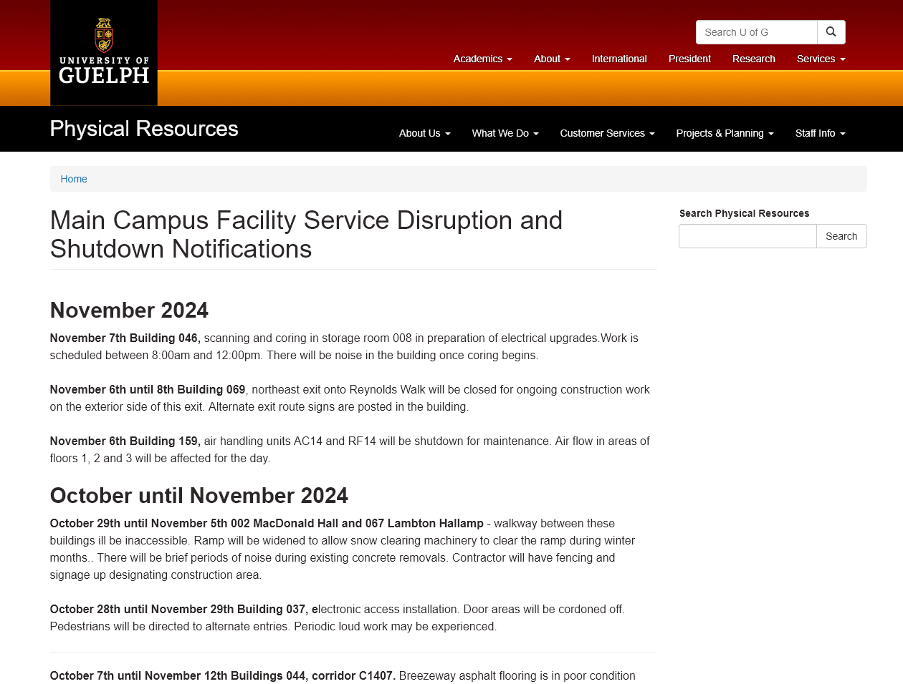

[Home](../index.md)
## What more can be done?

                For one, the University of Guelph could work to provide better information on the status of washrooms as well as the location of accessible washrooms. This could help to improve the experience for all campus community members. Furthermore, better information on availability could also help those on campus. An example of this could be via for instance a consolidated webpage and notification service that one could subscribe to in order to receive notifications on accessibility and other features unavailable for a sustained period. The University of Guelph notes that “the University makes every effort to provide notice to students, employees and the public when there is a temporary service disruption (planned or unexpected) at the University.”[\[1\]](#_ftn1) The page linked for information on disruptions regarding physical infrastructure has not been updated since 2024.[\[2\]](#_ftn2)

***

[\[1\]](#_ftnref1) “Accessible Customer Service - Service Disruption | Diversity and Human Rights (DHR),” accessed November 17, 2026, https\://www\.uoguelph.ca/diversity-human-rights/accessible-customer-service-service-disruption.

[\[2\]](#_ftnref2) “Main Campus Facility Service Disruption and Shutdown Notifications | Physical Resources,” accessed November 17, 2026, https\://www\.pr.uoguelph.ca/main-campus-facility-service-disruption-and-shutdown-notifications.
