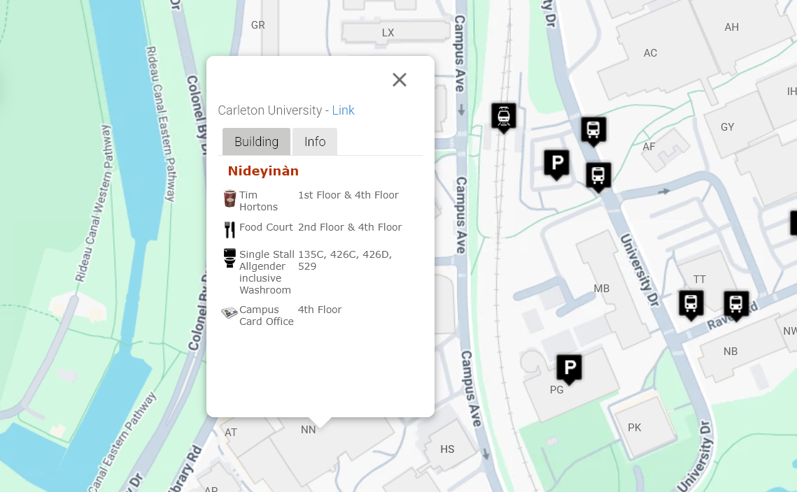
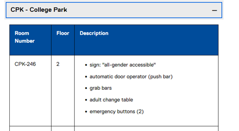

[Home](../index.md)

Back to [Guelph](Guelph.md)
## Guelph in comparison to other institutions

### Carleton
<https://carleton.ca/accessibility/>

                Carleton has some accessibility resources that Guelph does not appear to have, including in relationship to washrooms. Carleton University has adopted the Rick Hansen Accessibility Certification.[\[1\]](#_ftn1) Furthermore, Carleton’s campus map also allows one to click/tap on buildings to obtain information such as washroom presence, as seen in the figure below.[\[2\]](#_ftn2)

https://carleton.ca/campus-map/
### TMU

                The Toronto Metropolitan University maintains a list of single occupancy washrooms by building, including room number, floor, and a description of their accessibility features. This is great as it allows students, faculty, and broader members of the community to locate where the bathrooms they need are.[\[3\]](#_ftn3) This furthermore serves as an example of universal design, with accessibility features aiding all while taking every user into consideration; for instance, a fully abled person may still need a baby change table, and this would help them to locate one.[\[4\]](#_ftn4)

https\://www\.torontomu.ca/facilities-management-development/facilities-help-desk/accessibility-amenity-information/single-occupancy-washrooms/

Next: [What more can be done?](../Conclusion/WhatBetter.md)

***
[\[1\]](#_ftnref1) “Rick Hansen Accessibility Certification,” _Carleton News_, October 7, 2026, https\://carleton.ca/news/story/rick-hansen-accessibility-certification/.
[\[2\]](#_ftnref2) “Campus Map - Carleton University,” accessed November 17, 2026, https\://carleton.ca/campus-map/.
[\[3\]](#_ftnref3) “Single-Occupancy Washrooms,” Toronto Metropolitan University (TMU), accessed November 17, 2026, https\://www\.torontomu.ca/facilities-management-development/facilities-help-desk/accessibility-amenity-information/single-occupancy-washrooms/.
[\[4\]](#_ftnref4) Bourke, _Integrating Social Justice into Student Affairs_, 104.

