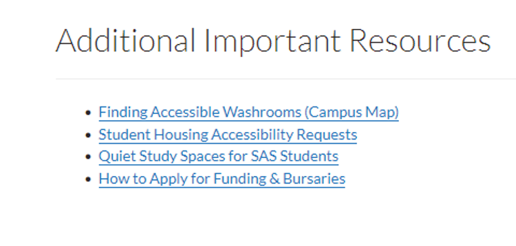

[Home](../index.md)
##### [Guelph](Guelph.md)
## What is Guelph Doing?

                The University of Guelph maintains a multi-year accessibility plan, with the current plan running from 2025-2027.[\[1\]](#_ftn1) It is based upon 7 pillars, of which the sixth, physical and architectural barriers, is most relevant.[\[2\]](#_ftn2)

                Guelph has also attempted to enhance maintenance of accessible spaces. The 2025-2027 Multi-Year Accessibility Plan notes that Student Accessibility Services are able to on behalf of students “submit complaints and improvement suggestions regarding accessibility issues in the built environment on campus.”[\[3\]](#_ftn3)

                There are also a few gaps in accessibility resources. For example, the Guelph accessibility resources webpage directs one to use the Campus Map to find accessible bathrooms.[\[4\]](#_ftn4) The map does not list bathrooms, unless the writers meant to use it to navigate to each building’s individual page.[\[5\]](#_ftn5)

                Guelph does not appear to have public records available on washroom availability percentages. While Guelph lists what washrooms are in each building on the building’s webpage with their floor number or general location and accessible stall information, this is limited. Guelph does however make commitments to design in the [Design and Construction standards](https://www.pr.uoguelph.ca/system/files/2026.04.01_UofG_Design_%26_Construction_Standards.pdf), with [Section 2.3.1.1.3 calling for standard to be used to create the “most accommodating environment” between federal, provincial, and municipal requirements and the Design and Construction Standards (2.3.1)](https://www.pr.uoguelph.ca/system/files/2026.04.01_UofG_Design_%26_Construction_Standards.pdf#page=28). The standards also call for consultants to have experience with the [OBC, AODA, and CSA B651 to best apply them as well as to follow the principles of Universal Design, including equitable use, flexibility in use, low physical effort, size and space for approach and use, and more (2.3.1.2 2.3.1.3.1. pg. 2.3.2)](https://www.pr.uoguelph.ca/system/files/2026.04.01_UofG_Design_%26_Construction_Standards.pdf#page=29). Universal design is vital for as it becomes for common and mainstream, it helps to centre disability in worldviews and helps to catalyse transformative access, with "all as involved" in social and learning and other space.[\[6\]](#_ftn6)

Recommended next: [Others and Guelph](GuelphOthers.md)

***

[\[1\]](#_ftnref1) “University of Guelph Accessibility Plans | Diversity and Human Rights (DHR),” accessed November 17, 2026, https\://www\.uoguelph.ca/diversity-human-rights/accessibility-resources/university-guelph-accessibility-plans.

[\[2\]](#_ftnref2) “University of Guelph’s Multi-Year Accessibility Plan 2025-2027,” University of Guelph, 2025, 17.

[\[3\]](#_ftnref3) “University of Guelph’s Multi-Year Accessibility Plan 2025-2027,” 17.

[\[4\]](#_ftnref4) “Accessibility Resources | Accessibility Services,” accessed November 17, 2026, https\://wellness.uoguelph.ca/accessibility/resources.

[\[5\]](#_ftnref5) “Campus Map | University of Guelph,” accessed November 17, 2026, http\://www\.uoguelph.ca/maps/.
[\[6\]](#_ftnref6) Jay T. Dolmage, _Academic Ableism: Disability and Higher Education_ (University of Michigan Press, 2017), 117-119, https\://doi.org/10.3998/mpub.9708722.
